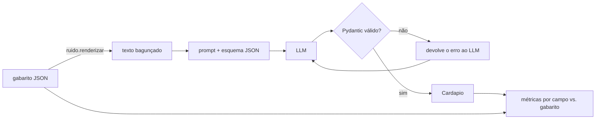

# Extração estruturada de cardápios com LLM

Pipeline que transforma cardápios bagunçados (texto de PDF, WhatsApp ou foto transcrita) em JSON validado — prato, preço, categoria e alergênicos — com avaliação campo a campo contra gabarito e comparação de prompts e modelos.

[](https://github.com/krosct/project-nov26-p2-cardapios/actions/workflows/ci.yml)

## Resultados

20 cardápios, 153 itens. Modelos gratuitos via OpenRouter, temperatura 0. A tabela mostra a 1ª execução; **3 execuções** (cache vazio nas duas últimas) dão a variação em [`reports/repeticoes.json`](reports/repeticoes.json): categoria zero-shot 0,98 / 0,97 / 0,95, few-shot 0,92 / 0,94 / 0,94, modelo pequeno 0,61 / 0,62 / 0,62; alergênicos do modelo pequeno (informado × não informado) 0,73 / 0,71 / 0,68. Nomes e preço não variam.

> ⚠️ **Os cardápios são sintéticos**: o texto bagunçado é gerado por template a partir do próprio gabarito, e os alergênicos vêm de um dicionário fixo de sinônimos. Por construção, tudo está dedutível do texto, então o modelo grande **satura o benchmark** (1,00 em nomes, preço e alergênicos). Os 1,00 medem o gerador de ruído, não a extração de cardápios reais; o que o benchmark separa bem é modelo grande × pequeno e a regra "não deduzir alergênicos".

Métricas de campo **por item** (média micro: soma dos itens de todos os cardápios), calculadas só sobre os itens casados com o gabarito (similaridade de nome ≥ 0,85).

| Configuração | Itens casados | F1 nomes | Preço | Categoria | Alergênicos (P / R) | "Informado × não informado" | Latência média |
|---|---|---|---|---|---|---|---|
| Nemotron 3 Ultra (550B), zero-shot | 153/153 | 1,00 | 1,00 | 0,98 | 1,00 / 1,00 | 1,00 | 21,3 s |
| Nemotron 3 Ultra, few-shot (2 exemplos) | 153/153 | 1,00 | 1,00 | 0,92 | 1,00 / 1,00 | 1,00 | 18,6 s |
| LFM 2.5 (2,6B), zero-shot | 144/153 | 0,94 | 1,00 | 0,61 | 0,88 / 0,97 | 0,73 | 6,5 s |

- 100% dos JSONs foram válidos; com o modelo pequeno, 15% só ficaram válidos na segunda tentativa (retry com o erro do Pydantic).
- **Few-shot ficou abaixo do zero-shot em categoria nas 3 execuções**, mas a diferença encolhe com a repetição (0,98 × 0,92 na 1ª; 0,95 × 0,94 na 3ª): é um efeito pequeno e instável, não uma regra e custou +58% de tokens de entrada. Na 1ª execução os erros extras eram petiscos classificados como `lanche` (os exemplos são de uma tapiocaria), hipótese que não foi isolada em experimento próprio. Os 3 erros restantes do zero-shot são ambíguos de verdade (pizza doce é `pizza` ou `sobremesa`?).
- **O modelo pequeno é 3× mais rápido, mas inseguro:** em 38 itens cujo cardápio **não declara** alergênicos, ele preencheu a lista mesmo assim — deduzindo pelos ingredientes ou afirmando que não havia alergênicos. Para alergias, esse é o erro que não pode acontecer.

## Como funciona



- **Esquema** ([`schema.py`](src/project_nov26_p2_cardapios/schema.py)): categorias e alergênicos são listas fechadas (`Literal`), preço não pode ser negativo, e `alergenos=None` (cardápio não informa) é diferente de `[]` (cardápio declara que não há).
- **Extrator** ([`extrator.py`](src/project_nov26_p2_cardapios/extrator.py)): se a resposta não valida, o erro do Pydantic volta ao modelo (até 3 tentativas).
- **Cliente LLM** ([`llm.py`](src/project_nov26_p2_cardapios/llm.py)): API compatível com OpenAI (troca de provedor por variável de ambiente), cache em disco e retry com espera exponencial.
- **Métricas** ([`metricas.py`](src/project_nov26_p2_cardapios/metricas.py)): casamento de itens por similaridade de nome (tolera "X Tudo" × "X-Tudo"), F1 de nomes, acurácia de preço e categoria, precisão/recall micro de alergênicos.

### Dados

Cardápios sintéticos de 20 restaurantes fictícios (pizzaria, japonês, vegano, nordestino, frutos do mar...). O **gabarito vem primeiro** ([`data/gabarito`](data/gabarito)) e o texto bagunçado é gerado a partir dele ([`ruido.py`](src/project_nov26_p2_cardapios/ruido.py), seed fixa): formatos de preço variados (`R$32`, `32,9`, `32.90`, `32 reais`), abreviações (`c/`, `qj`), seções com nomes diferentes, alergênicos declarados por sinônimos ("trigo", "derivados de leite", "crustáceos") e itens sem preço. Assim, tudo o que está no JSON está dedutível do texto, por construção. 11 dos 20 cardápios declaram alergênicos.

Exemplo de entrada ([`data/menus/menu_02.txt`](data/menus/menu_02.txt)):

```
Hot Roll de Salmão - salmão empanado com cream cheese - R$ 32,90
  Alérgicos: contém peixe, trigo e lactose
Yakisoba de Legumes - macarrão, legumes & molho shoyu - R$ 38,00
  Alérgicos: contém gluten e shoyu (soja)
```

## Como rodar

```bash
uv sync
echo "OPENROUTER_API_KEY=..." > .env                 # chave do OpenRouter (modelos :free)
uv run python scripts/evaluate.py                     # gera reports/resumo.json
```

`scripts/gerar_textos.py` regenera os textos a partir dos gabaritos. Outro modelo: `LLM_MODEL=<id> uv run python scripts/evaluate.py`.

## Decisões e trade-offs

- **Validação + retry em vez de confiar no "JSON mode":** muitos modelos gratuitos não suportam saída estruturada nativa; o laço com Pydantic funciona com qualquer modelo e deixa visível quantas tentativas cada um precisou.
- **Métricas determinísticas em vez de LLM como juiz:** com gabarito estruturado, comparar campos é mais barato, reproduzível e não erra.
- **`None` ≠ `[]` nos alergênicos:** é o que permite a um sistema downstream (ex.: um assistente) recusar responder "isso tem glúten?" quando o restaurante não informou — é exatamente o que o modelo pequeno quebra.
- **Cache de respostas:** reexecutar a avaliação não gasta requisições, e os números do README são reproduzíveis. `scripts/reagregar.py` refaz o `resumo.json` a partir dos CSVs sem chamar a API.

## Limitações e próximos passos

- Dados sintéticos: o modelo grande satura o benchmark em quase todos os campos, e os mesmos 20 cardápios serviram para escrever o prompt e para avaliar (não há conjunto de desenvolvimento separado; o prompt de sistema não mudou desde o commit anterior à primeira avaliação, mas o histórico não mostra iterações locais anteriores a esse commit). Próximo teste: 5 a 10 cardápios reais, rotulados à mão e usados só para avaliar. Próximo passo: cardápios reais (PDF/foto) e entrada por imagem com um modelo multimodal.
- 20 cardápios é pouco para diferenças pequenas (ex.: em categoria, zero-shot e few-shot variam 0,95–0,98 e 0,92–0,94 entre execuções).
- Categoria tem ambiguidade real; uma taxonomia com definições (ou múltiplas categorias por item) reduziria o "erro" que não é erro.
- Custo: em produção, o próximo experimento seria um modelo médio e pago, comparando custo por cardápio com a taxa de erros em alergênicos.
